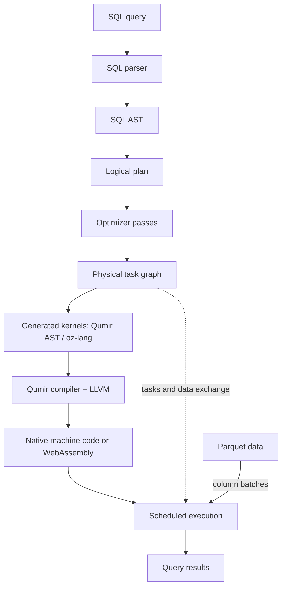

# QumirDB

**A compiled SQL engine for Parquet, running natively and in the browser.**

QumirDB runs analytical SQL queries directly over Parquet files: filtering
large datasets, joining tables, computing aggregates, and sorting results.
Use it from a native application or command line, or explore datasets in
the [browser workbench](https://db.qumir.dev).

QumirDB compiles the query's expressions and operator computations into
machine code or WebAssembly before processing data. An expression
interpreter evaluates a query through an expression tree or a sequence of
opcodes, even when it processes column batches and uses optimized SIMD
routines. QumirDB generates code specialized for the query's expressions
and types, which LLVM can optimize together.

The compilation layer comes from [Qumir](https://github.com/QumirLabs/qumir).
QumirDB generates kernels as Qumir ASTs; **oz-lang** is the S-expression
textual representation of that AST. Qumir lowers the generated computation
through its own SSA IR to LLVM. The same kernel generation path supports
native execution and WebAssembly execution over browser datasets.

Custom computations can use the same optimization pipeline. Register a Rust
module with `CREATE MODULE`, then call its functions from SQL. The module's
LLVM bitcode is linked with the generated query code before optimization,
allowing LLVM to inline functions, propagate constants, and vectorize across
the SQL and user-code boundary. See
[UDFs that disappear into the query](#udfs-that-disappear-into-the-query).

## How a query runs



The SQL parser builds a **SQL AST** that describes the query's syntax.
Logical planning resolves tables and columns and turns the query into
relational operators such as scans, joins, and aggregates. Optimizer passes
rewrite that plan: they push down predicates, choose join order, remove
unused columns, and attach Parquet row-group pruning conditions.

Physical lowering builds a graph of executable tasks and the connections
that carry data between them. It also generates the kernels those tasks
will call. These kernels use the **Qumir AST**, a separate representation
for executable computation, which Qumir and LLVM compile into one module
for the query.

At execution time, the scheduler runs the tasks, Parquet readers supply
column batches, and compiled kernels perform the query's computations.
Compiling the kernels together preserves the graph's operator boundaries,
data dependencies, and task state.

See [logical planning](docs/arch/logical_plan_build.md),
[kernel compilation](docs/arch/kernel-compilation-phases.md), and
[scheduled execution](docs/arch/scheduler_runtime.md) for the design.

## Project principles

1. **A database at the forefront of the field.** QumirDB draws on modern
   database ideas. Beauty, clarity, and coherence of code and architecture
   are the project's highest priority.

2. **All computation in [oz-lang](https://github.com/QumirLabs/qumir/blob/master/docs/arch/core-lang.md).** Operator computation is expressed in
   [oz-lang](https://github.com/QumirLabs/qumir/blob/master/docs/arch/core-lang.md) and executed through a pipeline compiled by the JIT.

3. **A pipeline split into operators and tasks.** Explicit execution
   boundaries and data exchange contracts provide the foundation for
   distributed execution across threads, processes, and nodes.

4. **Complex analytical queries.** The engine is designed for joins across
   many tables, complex join conditions, and correlated subqueries.

5. **Speed throughout query processing.** Optimize planning, compilation,
   and execution. Confirm improvements with measurements while preserving
   code and architecture quality.

## SQL, plainly

```sql
SELECT
    l_returnflag,
    l_linestatus,
    SUM(l_quantity)                       AS sum_qty,
    SUM(l_extendedprice)                  AS sum_base_price,
    SUM(l_extendedprice * (1 - l_discount)) AS sum_disc_price,
    AVG(l_discount)                       AS avg_disc,
    COUNT(*)                              AS count_order
FROM lineitem
WHERE l_shipdate <= DATE '1998-09-02'
GROUP BY l_returnflag, l_linestatus
ORDER BY l_returnflag, l_linestatus;
```

The planner applies many rewrites: join reorder, predicate pushdown, column
pruning, and Parquet row-group pruning. Each rewrite has a doc with a
minimal query and the plan before and after it, in
[docs/arch/optimizations.md](docs/arch/optimizations.md).

## UDFs that disappear into the query

Register a Rust module once, inline in SQL:

```sql
CREATE MODULE orbital LANGUAGE rust AS $$
#[no_mangle]
pub extern "C" fn orbit_is_neo(a: f64, e: f64) -> bool {
    a * (1.0 - e) < 1.3
}
$$;

CREATE FUNCTION orbit_is_neo(a DOUBLE, e DOUBLE) RETURNS BOOL
SET MODULE TO orbital;
```

Call it like any built-in function:

```sql
SELECT designation FROM sbdb_objects
WHERE orbit_is_neo(a, e) AND e < 0.3;
```

`orbit_is_neo` does not run through a function pointer call. Its Rust
bitcode joins the same LLVM module as the query kernel before optimization
starts. The compiler treats it just like SQL generated code. Without this,
a scalar call would stay inside the row loop, like this:

```llvm
%is_neo = call i1 @orbit_is_neo(double %a, double %e)
%low_e  = fcmp olt double %e, 0.3
```

After optimization, the call is gone. The code turns into a wide vector
loop instead. A test used a 32 million row, two column Parquet scan, on
one thread, on an Apple M5 Pro chip, with 20 paired runs. The kernel time
dropped from 292 ms to 108 ms. That is 2.72 times faster. Both numbers
include the Parquet scan cost.

A Rust struct becomes multiple SQL columns:

```sql
CREATE FUNCTION orbit_position(
    a DOUBLE, e DOUBLE, i DOUBLE, w DOUBLE,
    node DOUBLE, m DOUBLE, epoch DOUBLE, ts DOUBLE
) RETURNS (DOUBLE, DOUBLE, DOUBLE)
SET MODULE TO orbital;

SELECT orbit_position(a, e, i, w, node, m, epoch, ts) AS (x, y, z)
FROM unnumbered_asteroids;
```

The engine links Rust code before it runs optimization. Because of this,
the query can specialize the Rust code it calls. A mode argument can be a
constant value at query time. Then constant propagation can delete the
branch the query never uses:

```sql
CREATE FUNCTION hazard_score(diameter DOUBLE, velocity DOUBLE, mode INT)
RETURNS DOUBLE
SET MODULE TO orbital;

SELECT designation FROM sbdb_objects
WHERE hazard_score(diameter, velocity, 2) > 10;  -- 2 is a constant here
```

```rust
fn hazard_score(d: f64, v: f64, mode: i32) -> f64 {
    if mode == 2 { precise_model(d, v) } else { fast_model(d, v) }
}
```

The query around it stays a normal relational query. Joins, dates, grouping,
and aggregation stay in SQL. The domain model stays in Rust:

```sql
SELECT
    o.orbit_class,
    danger,
    COUNT(DISTINCT c.designation) AS asteroids,
    COUNT(*)                      AS approaches,
    MIN(c.dist_au)                AS closest_au,
    MAX(hazard_score(diameter, velocity, 2)) AS max_score
FROM close_approaches c
JOIN sbdb_objects o USING (designation)
LEFT JOIN sentry_virtual_impactors s USING (designation)
WHERE c.approach_date BETWEEN DATE '2026-08-13' AND DATE '2126-08-13'
  AND c.dist_au < 0.1
GROUP BY o.orbit_class, danger
ORDER BY danger DESC, o.orbit_class;
```

Parquet statistics prune row groups that do not matter, before the Rust
model runs at all. Scan tasks on separate threads feed normal columnar
batches into the fused kernels. The result is a small SQL table. It is not
a custom Rust output format.

## Why it exists

- **One optimizer, two languages.** SQL owns scans, predicate pushdown, join
  order, and grouping. Rust owns the domain logic that does not fit a query
  language: numeric models, parsers, state machines. LLVM optimizes both
  together, not one around the other.
- **Same query, two targets.** The native path uses a JIT to build host
  machine code. The browser path compiles the same fused kernel to
  WebAssembly. It runs against OPFS-backed datasets, with no server round
  trip per row.
- **Not tied to Rust.** Any language with an LLVM backend and a C ABI can use
  the same path. Rust just has no GC to fight and a small, clear boundary.
  See [external-module requirements](docs/building.md#external-modules).

## Try it

Live playground: **[db.qumir.dev](https://db.qumir.dev)**. Write SQL,
inspect the logical and physical plans, and run the query natively on the
server or in your own browser.

To build and run locally, see
[docs/building.md](docs/building.md).

## Architecture

Design notes live in [docs/arch/](docs/arch/README.md).

- [Optimizations](docs/arch/optimizations.md): every rewrite the engine does,
  with a minimal query and the plan before and after.
- [Logical plan build](docs/arch/logical_plan_build.md): SQL AST to operator
  tree, aggregate rewrites, CTEs.
- [Predicate pushdown](docs/arch/predicate_pushdown.md) and
  [join reorder](docs/arch/join_reorder.md): the two passes that decide how
  much data the scans return.
- [Aggregation](docs/arch/aggregation.md) and [join](docs/arch/join.md):
  generated kernels, hash tables, runtime ABI.
- [Scheduler runtime](docs/arch/scheduler_runtime.md) and
  [dispatch](docs/arch/dispatch.md): the physical graph, tasks and
  connections.
- [Late materialization](docs/arch/late_materialization.md): a narrow Parquet
  scan and late column fetches after a small `LIMIT`.
- [Kernel compilation phases](docs/arch/kernel-compilation-phases.md): how a
  plan becomes Qumir code, LLVM IR, and finally machine code or wasm.

## Repository layout

- `qdb/`: engine library. SQL/parser, logical plan, passes, kernel
  generation, execution, scheduler, parquet IO.
- `bin/`: the `qdb` command line tool.
- `service/`: web server and static browser workbench.
- `test/`: C++ unit and regression tests.
- `benchmark/`: TPC-H, TPC-DS, and ClickBench query packs and runners.
- [docs/benchmarks/](docs/benchmarks/README.md): benchmark methodology and results,
  with separate pages for ClickBench, TPC-H, and TPC-DS.
- `docs/arch/`: fundamental architecture and algorithms for the planner,
  scheduler, joins, aggregation, and kernel dispatch.

QumirDB is built on [Qumir](https://qumir.dev)
([GitHub](https://github.com/QumirLabs/qumir)), the compiler and runtime
layer for generated query kernels, and on
[Coroio](https://coroio.dev) ([GitHub](https://github.com/resetius/coroio)),
the coroutine-based web service runtime.
