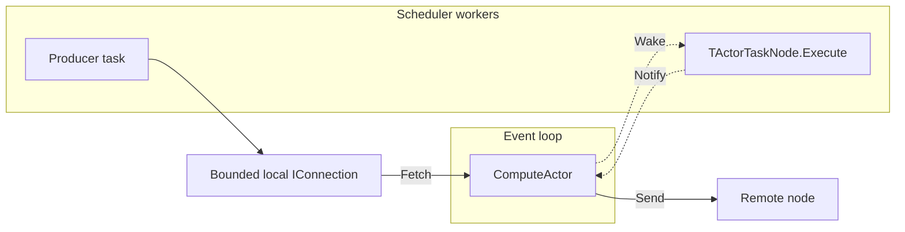

# Distributed placement

Node selection and compute actor creation have separate owners. The Scheduler
keeps node heartbeats and a round-robin cursor. It returns distinct local
scheduler IDs to the Query and retains no state for that request. Selection is
advisory: a selected node may fail before actor creation.

After receiving the placement, the Query creates a Collector. The Collector
splits the requested actor count evenly across the selected local schedulers
and requests creation directly. Local schedulers allow oversubscription; the
advertised worker count is not an admission limit.

The Collector gathers replies until all selected local schedulers respond, an
error occurs, or the allocation times out. It sends one result to the Query and
terminates. On failure it stops the compute actors whose IDs it has received;
it does not wait for late replies. Duplicate replies do not count toward
completion.

The Query-to-compute-actor lifecycle protocol, distributed query execution, and
graph partitioning are outside this preparatory change. Compute actor cleanup
when a Query disappears belongs to that future lifecycle protocol.

## Proposed task-to-actor exchange

An actor-backed task can connect the scheduler's worker pool to a ComputeActor
on the event loop. The producer writes into a bounded local connection; the
ComputeActor is its only consumer and performs `Fetch` and network `Send`.
The same connection provides buffering and backpressure across the thread
boundary.

The task checks the shared transfer state and wakes the actor through a
coalescing Notifier. It does not fetch rowsets itself. The actor drains the
connection as transport capacity permits. When it needs more input or finishes
the transfer, it publishes that state before waking the task. The next task
step can then request upstream work or report completion.

Task notifications use a bounded multiple-producer, single-consumer queue:
workers reserve slots with a producer-side compare-and-swap, while the actor
alone advances the read cursor. A slot becomes readable only after its value
has been published; an unfinished reservation is not skipped. Producers notify
after publication, so a delayed producer can wake the actor again. A full queue
rejects a push without moving its value. Element moves must not throw because
later producers may already have reserved slots beyond a failed publication.

The threaded scheduler supports external wakeups through a scheduler channel.
The channel holds a reference to `IThreadedScheduler` and directly calls its
thread-safe `Schedule` method. Producers publish progress before notifying the
corresponding graph node. A `WAITING` result suspends the task without requesting
upstream or downstream work. A notification received during execution records
a reschedule request; one received after suspension puts the task back into
the ready queue. Duplicate notifications do not cause concurrent execution.

The channel does not own the scheduler or graph: its caller must stop external
producers before destroying either. No binding or callback registration is
needed. The scheduler continues waiting when its ready queue is empty and the
root is unfinished. Root completion ends the run even if abandoned upstream
branches still await external events. The simple single-threaded scheduler
rejects external waits; the threaded implementation supports them even with
one worker.

The actor-specific bridge belongs in `qdbd`. Network data transfer and the
Query-to-compute-actor lifecycle protocol remain outside this preparatory work.
